<p align="center">
  <picture>
    <source media="(prefers-color-scheme: dark)" srcset="docs/assets/hero-dark.svg">
    
  </picture>
</p>

<p align="center">
  <b>Un serveur IRC écrit de zéro en C++98, pour le cursus 42.</b><br>
  Un seul <code>epoll</code> pour tous les sockets, des I/O non bloquantes, des canaux avec opérateurs et modes.<br>
  Branchez <a href="https://irssi.org">irssi</a>, rejoignez <code>#general</code>, discutez.
</p>

<p align="center">
  
  
  
  
  
  
</p>

<p align="center">
  <a href="#démarrage-rapide"></a>
</p>

<p align="center">
  <a href="#démarrage-rapide">Démarrage rapide</a> ·
  <a href="#comment-ça-marche">Comment ça marche</a> ·
  <a href="#commandes">Commandes</a> ·
  <a href="#modes-de-canal">Modes</a> ·
  <a href="#architecture">Architecture</a> ·
  <a href="#tests">Tests</a> ·
  <a href="#documentation">Docs</a>
</p>

<p align="center"></p>

## Démarrage rapide

**Prérequis :** Linux (le serveur utilise `epoll`), un compilateur C++98 et `make`.

```bash
make
./ircserv 6667 secret
```

| Argument   | Contrainte                         |
| ---------- | ---------------------------------- |
| `port`     | entre `1024` et `65535`            |
| `password` | 18 caractères au maximum           |

<details>
<summary>Sur macOS (pas d'<code>epoll</code>), passer par un conteneur Linux</summary>

```bash
docker run -it --rm -v "$PWD":/irc -w /irc -p 6667:6667 gcc:13 \
  sh -c "make && ./ircserv 6667 secret"
```

</details>

**Se connecter avec irssi**, le client de référence :

```text
irssi
/connect localhost 6667 secret
/nick alice
/join #general
/msg #general salut tout le monde
```

**Ou à la main avec netcat.** Le serveur découpe les commandes sur `\r\n` : l'option `-C` fait envoyer ce `\r\n` à `nc`.

```text
nc -C localhost 6667
PASS secret
NICK alice
USER alice 0 * :Alice
JOIN #general
PRIVMSG #general :salut
```

## Comment ça marche

Un seul processus, un seul thread, une seule boucle. Voici le trajet d'un `PRIVMSG` envoyé par alice sur `#general`, de son terminal jusqu'à ceux de bob et carol :

<p align="center">
  <picture>
    <source media="(prefers-color-scheme: dark)" srcset="docs/assets/flow-dark.svg">
    
  </picture>
</p>

1. **`send()`** : irssi écrit `PRIVMSG #general :salut\r\n` sur son socket TCP.
2. **`epoll_wait()`** : la boucle de `Server::runServer()` se réveille, le fd d'alice est prêt en lecture.
3. **`recv()` → buffer** : `parseInput()` ajoute les octets reçus au buffer d'alice. Rien n'est exécuté tant que la ligne n'est pas terminée par `\r\n`.
4. **`handleLine()`** : chaque ligne complète est extraite, son verbe passe en majuscules et part vers son handler, ici `handlePrivateMessage()`.
5. **broadcast** : le message est relayé à chaque membre du canal, sauf à son expéditeur.
6. **`send()` ×2** : bob et carol reçoivent `:alice!alice@localhost PRIVMSG #general :salut`.

Les quatre figures ci-dessous détaillent chaque mécanisme.

<table>
  <tr>
    <td width="50%" valign="top">
      <picture>
        <source media="(prefers-color-scheme: dark)" srcset="docs/assets/epoll-dark.svg">
        
      </picture>
      <p><b>1 · Une seule boucle <code>epoll</code></b><br>
      Le socket d'écoute et tous les clients sont enregistrés dans une même instance <code>epoll</code>. <code>epoll_wait()</code> ne renvoie que les fds prêts : la boucle les sert un par un, sans jamais bloquer. Quand le socket d'écoute s'allume, <code>accept()</code> ajoute un client en <code>EPOLLIN | EPOLLET</code>.</p>
    </td>
    <td width="50%" valign="top">
      <picture>
        <source media="(prefers-color-scheme: dark)" srcset="docs/assets/buffer-dark.svg">
        
      </picture>
      <p><b>2 · Un buffer par client</b><br>
      TCP ne garantit pas qu'une commande arrive d'un bloc. Chaque <code>recv()</code> s'ajoute au buffer du client (un point par octet sur la figure). Dès qu'un <code>\r\n</code> ferme la ligne, elle part vers <code>handleLine()</code> ; le reste attend la suite.</p>
    </td>
  </tr>
  <tr>
    <td width="50%" valign="top">
      <picture>
        <source media="(prefers-color-scheme: dark)" srcset="docs/assets/register-dark.svg">
        
      </picture>
      <p><b>3 · L'enregistrement</b><br>
      <code>PASS</code>, <code>NICK</code> et <code>USER</code> alignent chacun une goupille. Quand les trois sont en place, le serveur envoie <code>001 Welcome</code>. Avant ça, toute commande de canal ou de message reçoit <code>451 ERR_NOTREGISTERED</code>.</p>
    </td>
    <td width="50%" valign="top">
      <picture>
        <source media="(prefers-color-scheme: dark)" srcset="docs/assets/channel-dark.svg">
        
      </picture>
      <p><b>4 · Les canaux</b><br>
      Un canal garde ses membres, ses opérateurs (la collerette sur la figure), ses invités et ses modes. Un message envoyé au canal repart vers chaque membre, sauf son expéditeur. Le premier arrivé crée le canal et en devient opérateur.</p>
    </td>
  </tr>
</table>

## Commandes

| Famille        | Commandes                                         | Notes                                                    |
| -------------- | ------------------------------------------------- | -------------------------------------------------------- |
| Enregistrement | `CAP` · `PASS` · `NICK` · `USER` · `QUIT`         | `CAP LS` répond une liste vide, `CAP REQ` un `NAK`       |
| Canaux         | `JOIN` · `PART` · `TOPIC` · `INVITE` · `KICK` · `MODE` | `KICK` et `MODE` réservés aux opérateurs, `TOPIC` sous `+t` et `INVITE` sous `+i` aussi |
| Messages       | `PRIVMSG` · `NOTICE`                              | vers un pseudo ou un canal                               |
| Connexion      | `PING` · `PONG`                                   | keep-alive                                               |

Une fois enregistré, une commande inconnue reçoit `421 ERR_UNKNOWNCOMMAND`.

## Modes de canal

| Mode | Effet                                   | Exemple                     | Refus                         |
| ---- | --------------------------------------- | --------------------------- | ----------------------------- |
| `i`  | canal sur invitation uniquement         | `MODE #general +i`          | `473 ERR_INVITEONLYCHAN`      |
| `t`  | seuls les opérateurs changent le topic  | `MODE #general +t`          | `482 ERR_CHANOPRIVSNEEDED`    |
| `k`  | mot de passe du canal                   | `MODE #general +k s3cret`   | `475 ERR_BADCHANNELKEY`       |
| `o`  | donne ou retire le statut d'opérateur   | `MODE #general +o bob`      | `482 ERR_CHANOPRIVSNEEDED`    |
| `l`  | limite le nombre de membres             | `MODE #general +l 10`       | `471 ERR_CHANNELISFULL`       |

Les modes se combinent et se retirent avec `-` : `MODE #general +ik-l s3cret`.

## Architecture

```text
.
├── Makefile
├── includes/
│   ├── Server.hpp        # socket, epoll, boucle, routage des commandes
│   ├── User.hpp          # fd, pseudo, buffer de réception, état d'enregistrement
│   ├── Channel.hpp       # membres, opérateurs, invités, topic, modes i/t/k/l
│   ├── IrcReplies.hpp    # réponses numériques (RFC 1459 / 2812)
│   └── Utils.hpp
├── srcs/
│   ├── main.cpp          # arguments, signaux, initServer() puis runServer()
│   ├── Server.cpp        # acceptUser(), parseInput(), handleLine()
│   ├── User.cpp  Channel.cpp  IrcReplies.cpp  Utils.cpp
│   └── commands/
│       ├── registration/ # PASS, NICK, USER
│       ├── channel/      # JOIN, PART, KICK, TOPIC, INVITE, MODE
│       ├── messaging/    # PRIVMSG, NOTICE
│       └── query/        # PING / PONG
├── docs/                 # documentation détaillée (+ assets du README)
└── test_server.sh        # suite de tests
```

L'état tient dans `Server` : une `std::map<int, User>` indexée par fd et un `std::vector<Channel>`. Les fichiers de `commands/query/` et `commands/operator/` qui ne figurent pas dans le `Makefile` sont des pistes non compilées.

## Tests

```bash
make && ./test_server.sh
```

`test_server.sh` enchaîne 18 suites : arguments invalides, débordements, valeurs de port limites, encodages, signaux, stress réseau, commandes IRC malformées, fuzzing…

**Commande fragmentée**, le test classique de l'évaluation : envoyez une commande en plusieurs morceaux avec `Ctrl+D`, le serveur doit la reconstituer.

```text
nc -C localhost 6667
PA        ← Ctrl+D
SS sec    ← Ctrl+D
ret       ← Entrée
```

À vérifier aussi à la main : plusieurs clients en même temps, une déconnexion brutale (`kill -9` du client), un client suspendu par `Ctrl+Z` pendant que les autres parlent.

## Documentation

| Document                                          | Contenu                                               |
| ------------------------------------------------- | ----------------------------------------------------- |
| [protocol.md](docs/protocol.md)                   | le protocole IRC : format des messages, numériques    |
| [architecture.md](docs/architecture.md)           | classes, modules et flux de données                   |
| [technical.md](docs/technical.md)                 | sockets, I/O non bloquantes, multiplexage             |
| [commands.md](docs/commands.md)                   | chaque commande en détail, avec les références RFC    |
| [guide_irssi.md](docs/guide_irssi.md)             | prise en main d'irssi                                 |
| [testing.md](docs/testing.md)                     | stratégie et scénarios de test                        |
| [status.md](docs/status.md)                       | état d'avancement                                     |

<p align="center"></p>

<p align="center">
  <sub>Projet <b>ft_irc</b> de l'école 42, par <b>hdelacou</b> et <b>adrien</b>.<br>
  Illustrations dessinées avec le moteur <a href="https://lucasmarkes.com/lab/hairline">Hairline</a>.</sub>
</p>
